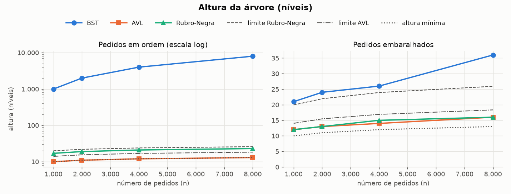
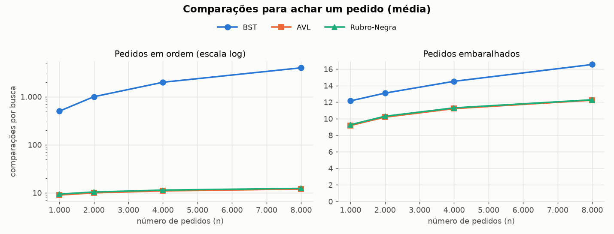
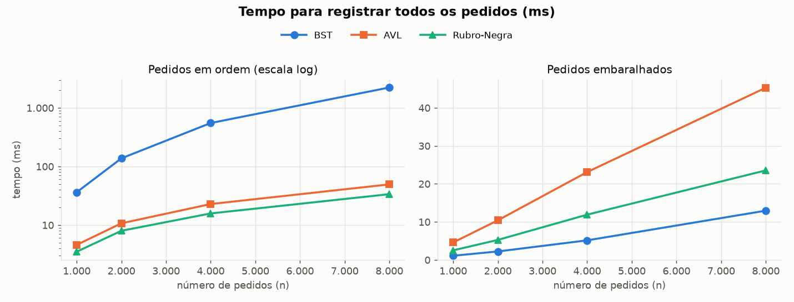
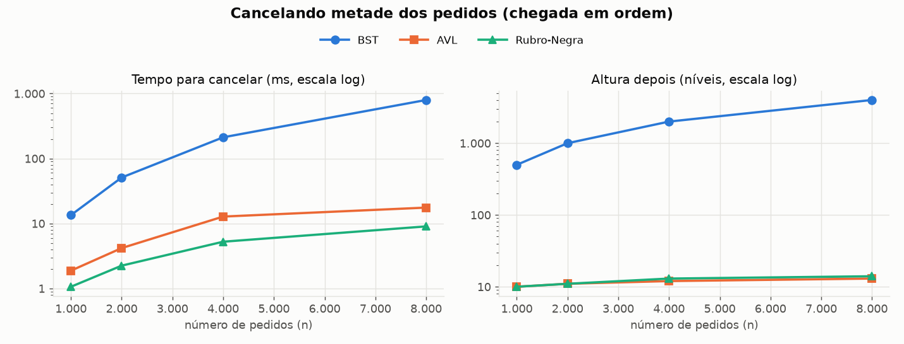
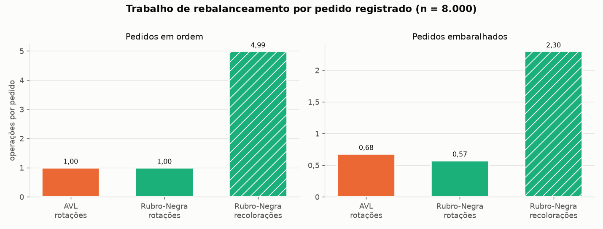
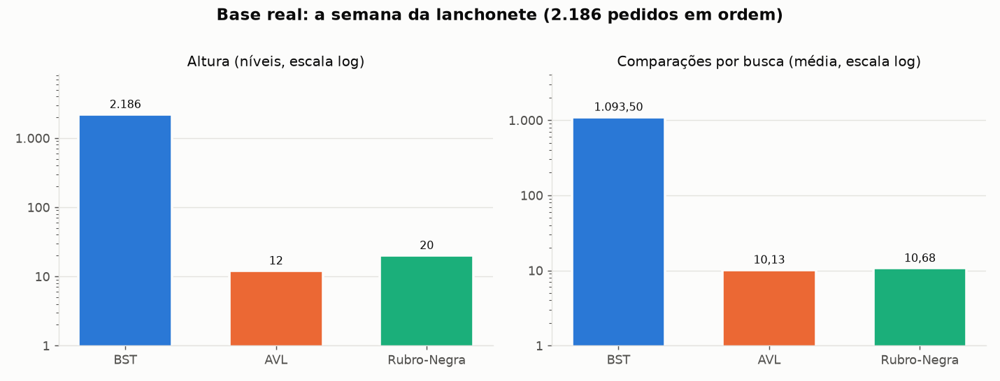

# Lanchonete em Árvores

Trabalho de **Estruturas de Dados 2** sobre árvores binárias de busca: **BST**, **AVL** e **Rubro-Negra** aplicadas aos pedidos de uma lanchonete.

| Uma semana de pedidos (2.186, chegando em ordem) | BST | AVL | Rubro-Negra |
|---|---:|---:|---:|
| Altura da árvore | 2.186 níveis | 12 níveis | 20 níveis |
| Comparações para achar um pedido (média) | 1.093,50 | 10,13 | 10,68 |

O número do pedido só cresce, e isso transforma a BST numa lista: para achar um pedido ela olha, em média, metade da semana. AVL e Rubro-Negra se reequilibram sozinhas e acham qualquer pedido com cerca de 10 comparações. **Recomendação: Rubro-Negra** (veja [Recomendação para a lanchonete](#recomendação-para-a-lanchonete)).

## Cenário

Cada pedido recebe um **número sequencial** no caixa (1, 2, 3...), e esse número é a chave da árvore. A árvore é o **registro de pedidos**: cresce a semana inteira e é consultada o tempo todo.

Escolhemos esse contexto porque os pedidos chegam **em ordem crescente**. Chaves chegando ordenadas são o pior caso da BST: cada número novo é maior que todos os anteriores, vai sempre para a direita, e a árvore vira uma lista encadeada. É exatamente esse problema que as árvores balanceadas resolvem.

| Na lanchonete | Na árvore |
|---|---|
| Consultar o pedido #152 | busca |
| Novo pedido no caixa | inserção |
| Cancelar um pedido | remoção |
| Próximo pedido a preparar | sucessor do último entregue |
| Pedido registrado depois do #152 | sucessor |
| Painel da cozinha; fechamento de caixa do #1 ao #331 | busca por intervalo |

## Base de dados

[`dados/pedidos.csv`](dados/pedidos.csv): **2.186 pedidos simulados** de uma semana (16/11 a 22/11/2026), com a lanchonete aberta das 11:00 às 23:00. Os números são sequenciais e acompanham o horário. Cada pedido tem de 1 a 4 itens do cardápio, e o valor é a soma dos itens. 165 pedidos terminaram cancelados.

Campos: `numero, data_hora, cliente, itens, valor, status`.

A base é gerada por [`dados/gerar_base.py`](dados/gerar_base.py) com semente 42: rodar de novo gera o mesmo arquivo (um teste confere isso).

## Estrutura

```
├── dados/
│   ├── gerar_base.py      # gerador da base (semente 42)
│   └── pedidos.csv
├── src/
│   ├── pedidos.py          # Pedido, cardápio e leitura do CSV
│   ├── lanchonete.py       # regras da lanchonete, sobre qualquer uma das árvores
│   ├── visual.py           # desenho das árvores em DOT (Graphviz) para a interface
│   └── arvores/
│       ├── base.py         # comum a todas: busca, mínimo, sucessor, intervalo, altura, desenho
│       ├── bst.py          # BST sem balanceamento
│       ├── avl.py          # AVL
│       └── rubro_negra.py  # Rubro-Negra
├── tests/
│   ├── test_arvores.py     # operações comuns, rodam em todas as árvores
│   ├── test_avl.py         # casos de rotação, fator e altura da AVL
│   ├── test_rubro_negra.py # casos de inserção e remoção, regras e altura da Rubro-Negra
│   ├── test_lanchonete.py  # regras da lanchonete nas três árvores e a demonstração
│   ├── test_comparacao.py  # benchmark e gráficos
│   ├── test_app.py         # desenho DOT e interface
│   └── test_pedidos.py     # base de dados e gerador
├── assets/                 # resultados.json e gráficos do benchmark
├── main.py                 # demonstração passo a passo no terminal
├── app.py                  # interface Streamlit
├── comparacao.py           # benchmark -> assets/resultados.json
├── graficos.py             # gráficos -> assets/*.png
└── requirements.txt        # matplotlib e streamlit
```

## Como rodar

Python 3.10 ou mais novo. Árvores, testes, demonstração e benchmark usam só a biblioteca padrão; os gráficos e a interface precisam de `matplotlib` e `streamlit`. Todos os comandos na raiz do projeto:

```bash
python main.py                    # demonstração (python main.py 3 roda só a parte 3)
python -m unittest -v             # testes
pip install -r requirements.txt   # matplotlib e streamlit
streamlit run app.py              # interface no navegador (http://localhost:8501)
python comparacao.py              # benchmark (~1 min) -> assets/resultados.json
python graficos.py                # gráficos -> assets/*.png
python -m dados.gerar_base        # gera dados/pedidos.csv de novo (opcional)
```

## Parte comum

[`src/arvores/base.py`](src/arvores/base.py) concentra tudo o que só **consulta** a árvore e é igual em qualquer árvore binária de busca: buscar, mínimo, máximo, sucessor, intervalo, percurso em ordem, altura e desenho no terminal. Cada árvore implementa só o que muda: inserir, remover e validar as próprias regras.

Os métodos são **iterativos**: com os pedidos em ordem, a BST chega a milhares de níveis, e uma recursão dessa profundidade estoura o limite do Python.

O desenho mostra a árvore deitada, com a raiz à esquerda, o filho direito acima e o esquerdo abaixo:

```
    ┌── #7
┌── #6
│   └── #5
#4
│   ┌── #3
└── #2
    └── #1
```

## BST

[`src/arvores/bst.py`](src/arvores/bst.py) · **Regra:** menores à esquerda, maiores à direita. Busca, inserção e remoção custam O(h), onde h é a altura.

A BST nunca se reorganiza: a altura depende só da ordem de chegada. Com a base real na ordem do arquivo, a altura é **2.186**, igual ao número de pedidos. Para achar o pedido #k são k comparações, então a média é (n + 1) / 2.

Remoção: a folha sai; o nó com um filho é trocado pelo filho; o nó com dois filhos recebe o sucessor (o menor da subárvore direita), e quem sai é o sucessor.

## AVL

[`src/arvores/avl.py`](src/arvores/avl.py) · **Regra:** em todo nó, o fator `altura(esquerda) - altura(direita)` fica entre -1 e +1. Isso limita a altura a cerca de 1,44 · log2(n), então busca, inserção e remoção custam O(log n).

Depois de inserir ou remover, cada nó do caminho recalcula a própria altura. Se o fator chegar a +2 ou -2, a árvore rotaciona:

| Caso | Fator do nó | Fator do filho | Correção |
|---|:-:|:-:|---|
| esquerda-esquerda | +2 | ≥ 0 | rotação à direita |
| esquerda-direita | +2 | < 0 | rotação à esquerda no filho, depois à direita |
| direita-direita | -2 | ≤ 0 | rotação à esquerda |
| direita-esquerda | -2 | > 0 | rotação à direita no filho, depois à esquerda |

O filho com fator 0 só aparece na **remoção**; na inserção ele sempre pende para um dos lados.

Na inserção, uma correção (1 ou 2 rotações) no nó desequilibrado mais baixo já basta, porque a subárvore volta à altura que tinha antes. Na remoção, corrigir um nó pode diminuir a altura da subárvore e desequilibrar o de cima, então a correção pode subir até a raiz.

Com os pedidos chegando em ordem, cai sempre no caso **direita-direita**. Com `AVL(verbose=True)` a árvore imprime cada caso e cada rotação, e o desenho mostra o fator de cada nó:

```
  inserir 1
  inserir 2
  inserir 3
    [AVL] caso direita-direita em #1 (fator -2)
    [AVL] rotação à esquerda em #1 (#2 sobe)
  inserir 4
  inserir 5
    [AVL] caso direita-direita em #3 (fator -2)
    [AVL] rotação à esquerda em #3 (#4 sobe)
  inserir 6
    [AVL] caso direita-direita em #2 (fator -2)
    [AVL] rotação à esquerda em #2 (#4 sobe)
  inserir 7
    [AVL] caso direita-direita em #5 (fator -2)
    [AVL] rotação à esquerda em #5 (#6 sobe)

    ┌── #7 [f=+0]
┌── #6 [f=+0]
│   └── #5 [f=+0]
#4 [f=+0]
│   ┌── #3 [f=+0]
└── #2 [f=+0]
    └── #1 [f=+0]
```

Os mesmos 7 pedidos que deixam a BST com 7 níveis ficam com 3 na AVL. Com números em ordem, a AVL termina sempre com a **menor altura possível**, ⌊log2 n⌋ + 1: a base real inteira (2.186 pedidos) cabe em **12 níveis**, contra 2.186 na BST.

## Rubro-Negra

[`src/arvores/rubro_negra.py`](src/arvores/rubro_negra.py) · **Regras** (Cormen, cap. 13):

1. todo nó é vermelho ou preto;
2. a raiz é preta;
3. toda folha vazia é preta;
4. nó vermelho não tem filho vermelho;
5. todo caminho de um nó até as folhas vazias passa pela mesma quantidade de nós pretos (a *altura preta*).

Juntas, elas limitam a altura a 2 · log2(n + 1). As regras são mais folgadas que as da AVL: a árvore fica um pouco mais alta, mas se rebalanceia com menos rotações, trocando cores (*recolorações*).

Todas as folhas vazias e o pai da raiz são **o mesmo nó sentinela preto**. Assim todo nó tem pai e filhos de verdade, com cor, e o código não precisa testar "está vazio?" a cada passo.

**Inserção.** O nó novo entra vermelho, então a única regra que pode quebrar é a 4 (pai vermelho). Quem decide o caso é o **tio**:

| Caso | Situação | Correção |
|---|---|---|
| 1 | tio vermelho | recolore pai, tio e avô; o problema sobe para o avô |
| 2 | tio preto, nó em "joelho" (filho direito de um filho esquerdo, ou o espelho) | rotação no pai; vira o caso 3 |
| 3 | tio preto, nó em linha reta | recolore e rotação no avô; fim |

No máximo 2 rotações por inserção.

**Remoção.** Se o nó que sai é preto, um caminho fica com um preto a menos: o *duplo preto*. Quem decide o caso é o **irmão** do nó que ficou com o duplo preto:

| Caso | Situação | Correção |
|---|---|---|
| 1 | irmão vermelho | recolore e rotação no pai; vira o caso 2, 3 ou 4 |
| 2 | irmão preto com os dois filhos pretos | irmão fica vermelho; o problema sobe para o pai |
| 3 | irmão preto, sobrinho de perto vermelho | rotação no irmão; vira o caso 4 |
| 4 | irmão preto, sobrinho de longe vermelho | recolore e rotação no pai; fim |

No máximo 3 rotações por remoção. Cada caso tem a versão espelhada (esquerda ↔ direita).

Com `RubroNegra(verbose=True)` a árvore imprime cada caso, e o desenho marca cada nó com `[V]` (vermelho) ou `[P]` (preto). Os mesmos 7 pedidos em ordem:

```
  inserir 1
  inserir 2
  inserir 3
    [Rubro-Negra] caso 3 em #3: tio preto em linha reta -> recolore e rotação no avô #1
    [Rubro-Negra] rotação à esquerda em #1 (#2 sobe)
  inserir 4
    [Rubro-Negra] caso 1 em #4: tio #1 vermelho -> recolore e sobe para o avô #2
  inserir 5
    [Rubro-Negra] caso 3 em #5: tio preto em linha reta -> recolore e rotação no avô #3
    [Rubro-Negra] rotação à esquerda em #3 (#4 sobe)
  inserir 6
    [Rubro-Negra] caso 1 em #6: tio #3 vermelho -> recolore e sobe para o avô #4
  inserir 7
    [Rubro-Negra] caso 3 em #7: tio preto em linha reta -> recolore e rotação no avô #5
    [Rubro-Negra] rotação à esquerda em #5 (#6 sobe)

        ┌── #7 [V]
    ┌── #6 [P]
    │   └── #5 [V]
┌── #4 [V]
│   └── #3 [P]
#2 [P]
└── #1 [P]
```

| Mesmos pedidos, em ordem | BST | AVL | Rubro-Negra |
|---|---:|---:|---:|
| 7 pedidos: altura | 7 | 3 | 4 |
| 7 pedidos: rotações | 0 | 4 | 3 |
| Base real (2.186 pedidos): altura | 2.186 | 12 | 20 |

A Rubro-Negra fica mais alta que a AVL (20 contra 12 níveis na base real), mas dentro do limite de 2 · log2(2.187) ≈ 22,2.

## A lanchonete

[`src/lanchonete.py`](src/lanchonete.py) traduz cada pedido do dia a dia numa operação da árvore. A árvore é escolhida na criação (`Lanchonete(AVL)`, `Lanchonete(BST)`...), então o mesmo código roda sobre as três.

| Método | Operação na árvore | O que faz |
|---|---|---|
| `novo_pedido` | inserção | registra com o próximo número; recusa item fora do cardápio |
| `consultar` | busca | devolve o pedido, ou nada se ele não existe ou foi cancelado |
| `cancelar` | remoção | só pedido em preparo; entregue não cancela |
| `proximo_a_preparar` / `entregar_proximo` | sucessor | a cozinha atende em ordem de chegada |
| `em_preparo` | intervalo | painel da cozinha: do último entregue até o último número |
| `pedido_seguinte` | sucessor | o pedido registrado logo depois de um número (cancelados não contam) |
| `pedidos_entre` / `fechamento` | intervalo | pedidos de um trecho de números e o total vendido |

Como a cozinha entrega em ordem, todo pedido até o último entregue está entregue, e todo pedido acima dele está em preparo. Por isso o próximo a preparar é o **sucessor** do último entregue, em O(log n), sem percorrer a lista de pedidos. Cancelados já saíram da árvore, e o sucessor pula por cima deles. O número do caixa nunca volta atrás, nem depois de um cancelamento.

`Lanchonete.da_base()` reproduz a semana do CSV: registra os 2.186 pedidos em ordem e depois cancela os 165 cancelados.

## Demonstração

`python main.py` mostra, desenhando as árvores no terminal:

1. **BST com 7 pedidos em ordem** vira uma escada (altura 7).
2. **AVL e Rubro-Negra** com os mesmos pedidos: cada caso, rotação e recoloração (altura 3 e 4).
3. **Cancelamentos** dos 3 primeiros pedidos: a BST continua torta, e AVL e Rubro-Negra se reorganizam.
4. **A semana inteira** nas três árvores, com os limites teóricos ao lado:

   | 2.186 pedidos em ordem | BST | AVL | Rubro-Negra |
   |---|---:|---:|---:|
   | altura | 2.186 | 12 | 20 |
   | comparações por busca (média) | 1.093,50 | 10,13 | 10,68 |
   | rotações (inserções e cancelamentos) | 0 | 2.174 | 2.171 |
   | recolorações | - | - | 11.528 |
   | altura depois dos 165 cancelamentos | 2.021 | 12 | 14 |

   Altura mínima possível: 12 · limite da AVL: 15,7 · limite da Rubro-Negra: 22,2.

5. **A lanchonete funcionando** sobre a AVL: pedidos novos, pedido recusado, painel da cozinha, consulta, cancelamento, entrega e fechamento de caixa de segunda-feira (304 pedidos entregues, R$ 12.529,00).

A saída é forçada para UTF-8, para os desenhos (`┌──`) aparecerem no terminal do Windows.

## Interface

`streamlit run app.py` abre a lanchonete no navegador, com três abas:

- **Caixa e cozinha:** o registro começa com a semana da base real. Registrar, consultar, cancelar e entregar rodam **nas três árvores ao mesmo tempo**, com os mesmos pedidos. Depois de cada operação aparecem, para cada árvore, a altura e quantas comparações aquela operação custou: na BST, consultar o #5 custa 5 comparações e consultar os últimos da semana custa perto de 2.000, contra 10 a 12 nas balanceadas. Embaixo ficam o painel da cozinha e o fechamento de caixa (busca por intervalo).
- **Passo a passo:** uma árvore pequena, montada pedido a pedido ("Chegou o pedido #8", "Chegaram 7 pedidos em ordem", "Cancelar #3"). O desenho mostra o fator de cada nó na AVL e pinta os nós de vermelho e preto na Rubro-Negra, e embaixo aparece cada caso, rotação e recoloração da última operação.
- **Comparação:** o registro atual nas três árvores (altura, comparações por busca, rotações e recolorações) e os gráficos do benchmark.

O desenho usa Graphviz pelo próprio Streamlit (`st.graphviz_chart`), sem instalar nada além do `requirements.txt`.

## Resultados

[`comparacao.py`](comparacao.py) dá as mesmas entradas (semente 42) para as três árvores em 4 cenários:

| Cenário | O que acontece |
|---|---|
| em ordem | pedidos chegando em ordem de número, como no caixa (pior caso da BST) |
| embaralhado | os mesmos números em ordem aleatória (caso médio da BST) |
| cancelamentos | chegada em ordem e, depois, metade dos pedidos cancelada ao acaso |
| base real | os 2.186 pedidos do CSV e os 165 cancelamentos |

Cada rodada termina com `validar()`: o número só vale se a árvore terminou correta. **Altura, comparações, rotações e recolorações não dependem da máquina** (são sempre as mesmas para a mesma entrada). **Os tempos dependem**: são a mediana de 3 execuções, medidos com Python 3.14 no Windows. Dados completos em [`assets/resultados.json`](assets/resultados.json).

| n = 8.000 pedidos | BST | AVL | Rubro-Negra |
|---|---:|---:|---:|
| **Em ordem:** altura (níveis) | 8.000 | 13 | 23 |
| comparações por busca (média) | 4.000,50 | 11,98 | 12,39 |
| rotações / recolorações (total) | 0 | 7.987 | 7.977 / 39.882 |
| tempo para registrar os 8.000 | 2.227,4 ms | 49,5 ms | 33,7 ms |
| tempo para buscar os 8.000 | 2.250,1 ms | 8,4 ms | 8,5 ms |
| **Embaralhado:** altura (níveis) | 36 | 16 | 16 |
| comparações por busca (média) | 16,55 | 12,23 | 12,28 |
| rotações / recolorações (total) | 0 | 5.436 | 4.598 / 18.388 |
| tempo para registrar os 8.000 | 13,0 ms | 45,3 ms | 23,6 ms |
| **Cancelando 4.000 dos 8.000:** tempo para cancelar | 796,3 ms | 17,6 ms | 9,0 ms |
| rotações / recolorações (total) | 0 | 652 | 761 / 9.698 |
| altura depois (níveis) | 4.000 | 13 | 14 |

Limites teóricos para 8.000 pedidos: altura mínima 13 · AVL até 18,4 · Rubro-Negra até 25,9.

**Como ler:** altura = número de níveis da árvore; comparações = quantas chaves a busca olha, em média, até achar o pedido; rotações e recolorações = total de operações de rebalanceamento na rodada inteira; tempos em milissegundos.

<p>
 
 
 
</p>

**O que os números mostram:**
- **BST:** com os pedidos em ordem ela vira uma lista: a altura é igual ao número de pedidos e a busca percorre metade do registro. Registrar os 8.000 pedidos leva 2,2 s, **45 vezes** mais que a AVL e **66 vezes** mais que a Rubro-Negra, e buscar todos leva 2,25 s contra 8 ms. Cancelar metade não conserta (a altura cai para 4.000, metade de uma lista ainda é uma lista). Embaralhada ela é a mais rápida para registrar, porque não rebalanceia nada, mas o caixa nunca entrega números embaralhados.
- **AVL:** a mais baixa. Com pedidos em ordem ela fica exatamente na **altura mínima** (13 níveis para 8.000) e é a que menos compara na busca. O preço é quase **uma rotação por pedido registrado** (7.987 para 8.000).
- **Rubro-Negra:** mais alta (23 níveis em ordem, dentro do limite de 25,9), mas a busca compara só 3% a mais que a AVL e leva o mesmo tempo. Rotaciona menos quando a ordem é aleatória (4.598 contra 5.436) e troca muitas cores (cerca de 5 por pedido em ordem), que é uma operação barata. Foi a **mais rápida para registrar e para cancelar** entre as balanceadas: 33,7 contra 49,5 ms registrando em ordem e 9,0 contra 17,6 ms cancelando.
- Cancelar metade dos pedidos **baixa** a Rubro-Negra de 23 para 14 níveis: as remoções desmontam a coluna alta que a chegada em ordem cria do lado direito.

## Recomendação para a lanchonete

**Não usar a BST.** O caixa entrega os números em ordem, que é o pior caso dela: o registro vira uma lista, e com uma semana de pedidos cada consulta olha mais de mil pedidos. Cancelar não conserta.

**Usar a Rubro-Negra.** O registro de pedidos recebe muita escrita: cada pedido é registrado uma vez, no pico do almoço e do jantar, e cancelamentos acontecem o tempo todo. Nesse uso a Rubro-Negra foi a melhor das balanceadas:
- registrou 8.000 pedidos em ordem em **33,7 ms**, contra 49,5 ms da AVL (32% menos tempo);
- cancelou 4.000 pedidos em **9,0 ms**, contra 17,6 ms da AVL (metade do tempo);
- na busca, compara só 3% a mais que a AVL (12,39 contra 11,98), e na prática buscou os 8.000 pedidos no mesmo tempo (8,5 contra 8,4 ms).

Ela rebalanceia com regras mais folgadas e troca cores, que custa pouco, no lugar de parte das rotações. É a mesma escolha do `TreeMap` do Java e do `std::map` do C++.

A **AVL** seria a escolha num sistema quase só de leitura, como consultar o histórico de semanas já fechadas: ela é a mais baixa (fica na altura mínima com pedidos em ordem) e a que menos compara. Mesmo assim, a diferença na busca é pequena.

## Testes

Depois das operações, `validar()` confere as regras da árvore, e o conteúdo é comparado com um dicionário comum, que serve de resultado esperado.

- **Todas as árvores** ([`test_arvores.py`](tests/test_arvores.py)): árvore vazia, número repetido, remoção de folha, nó com um filho e nó com dois filhos, 3.000 inserções e remoções misturadas, sucessor e intervalo. Aqui `validar()` confere a ordem das chaves e o tamanho.
- **AVL** ([`test_avl.py`](tests/test_avl.py)): um teste para cada um dos 4 casos de rotação, o caso de filho equilibrado na remoção, no máximo 2 rotações por inserção, altura dentro do limite teórico e mínima com números em ordem. Aqui `validar()` também confere a altura guardada e o fator de cada nó; um teste monta uma árvore desequilibrada à mão para garantir que a validação acusa o erro.
- **Rubro-Negra** ([`test_rubro_negra.py`](tests/test_rubro_negra.py)): os 3 casos de inserção (com os espelhos) e os 4 casos de remoção, cada um num exemplo pequeno; no máximo 2 rotações por inserção e 3 por remoção; altura dentro do limite teórico. Aqui `validar()` confere as 5 regras, a sentinela e o ponteiro para o pai de cada nó; um teste quebra cada regra à mão para garantir que a validação acusa o erro.
- **Lanchonete** ([`test_lanchonete.py`](tests/test_lanchonete.py)): cada regra (novo pedido, recusa, cancelamento, entrega em ordem, painel, fechamento) roda sobre as três árvores e precisa dar o mesmo resultado nas três; a demonstração inteira roda sem erro.
- **Benchmark** ([`test_comparacao.py`](tests/test_comparacao.py)): as contagens são iguais em toda rodada, os cenários usam os mesmos números, os valores conhecidos batem (BST em ordem: altura n e (n + 1) / 2 comparações; AVL em ordem: altura mínima), e o JSON e os 6 gráficos são gerados (o teste dos gráficos é pulado se o matplotlib não estiver instalado).
- **Interface** ([`test_app.py`](tests/test_app.py)): o desenho DOT tem um nó por pedido, uma aresta por filho, o nó invisível que mantém o filho único do lado certo, o fator da AVL e as cores da Rubro-Negra. A interface é exercitada sem navegador (`streamlit.testing`): registrar, entregar e recusar um cancelamento nas três árvores, e o passo a passo com o botão acompanhando o próximo número (pulado se o streamlit não estiver instalado).

## Referências

- T. Cormen, C. Leiserson, R. Rivest e C. Stein. *Introduction to Algorithms*, cap. 12 (árvores binárias de busca) e cap. 13 (árvores rubro-negras).
- G. Adelson-Velsky e E. Landis. *An algorithm for the organization of information*, 1962 (artigo original da AVL).

## Integrantes

| Matrícula | Nome |
|---|---|
| 231011097 | André Meyer |
